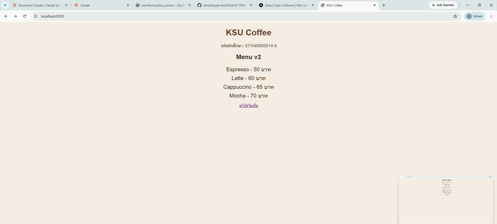
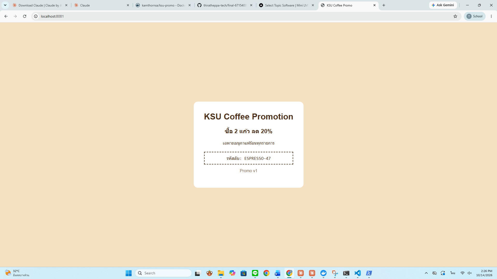

# ANSWER — Thirathep Phanpadab 671540005014-9

## Part A — ข้อมูลจาก image kamthornsa/ksu-promo:1.0

| คำถาม | คำตอบ | คำสั่งที่ใช้ |
| --- | --- | --- |
| Port | 3000 (ผลลัพธ์ขึ้น `3000/tcp` และ `80/tcp` โดย 80 ตกทอดมาจาก base image nginx, port ที่แอปใช้จริงคือ 3000) | `docker image inspect kamthornsa/ksu-promo:1.0 --format "{{.Config.ExposedPorts}}"` |
| CMD | `nginx -g "daemon off;"` (มี Entrypoint คือ `/docker-entrypoint.sh`) | `docker image inspect kamthornsa/ksu-promo:1.0 --format "Cmd={{.Config.Cmd}} Entrypoint={{.Config.Entrypoint}}"` |
| Base image | nginx:alpine (Alpine minirootfs 3.24.2 + nginx 1.31.6) | `docker history kamthornsa/ksu-promo:1.0 --no-trunc` |

## Part B — รหัสลับบนหน้าโปรโมชั่น

`ESPRESSO-47`

## Part C — คำถาม

1. หน้าโปรโมชั่นเป็น image สำเร็จรูปที่เราไม่มีซอร์สโค้ด เนื้อหาถูกฝังอยู่ใน layer ของ image ซึ่งเป็นแบบอ่านอย่างเดียว เราจึงแก้ข้อความไม่ได้ ส่วนหน้าเมนูเรามี index.html และ Dockerfile ของตัวเอง แก้ไฟล์แล้ว build ใหม่ก็เปลี่ยนหน้าได้

2. เมื่อเขียน `image: kamthornsa/ksu-promo` โดยไม่ใส่ tag Docker จะใช้ tag `latest` อัตโนมัติ ผมทดลองจริงด้วย `docker pull kamthornsa/ksu-promo` ผลคือ error `kamthornsa/ksu-promo:latest: not found` เพราะบน Docker Hub มี tag เดียวคือ `1.0` ไม่มี `latest` จึงดึง image ไม่ได้และไม่ได้หน้าเว็บเลย ต้องระบุ tag ให้ชัดเจนเสมอ

3. เลขซ้ายคือ port ของเครื่องโฮสต์ ที่เราเปิดผ่านเบราว์เซอร์ (localhost:8081) เลขขวาคือ port ภายใน container ที่แอปฟังอยู่ ฝั่งขวาไม่ใช่ 80 เพราะ image นี้ให้แอปฟังที่ port 3000 (ตรวจจาก docker image inspect) ถ้าใส่ 80 จะต่อไม่ติด

4. จะไม่เห็นหน้าเว็บเปลี่ยน เพราะ `docker compose up -d` ใช้ image ที่ build ไว้แล้วต่อไป ไม่ได้ build ใหม่ให้เอง ต้องสั่ง `docker compose up -d --build` เพื่อ build image ใหม่และสร้าง container menu ใหม่ โดย promo ไม่ถูกแตะและยังทำงานอยู่

5. ลิงก์ใช้ `http://localhost:8081` ใช้ `http://promo:3000` ไม่ได้ เพราะลิงก์ถูกคลิกในเบราว์เซอร์บนเครื่องโฮสต์ ไม่ใช่ใน container เบราว์เซอร์ไม่รู้จักชื่อ promo และ port 3000 ไม่ได้เปิดออกมาที่โฮสต์ ชื่อ service ใช้ได้เฉพาะระหว่าง container ใน network ของ Compose

## ภาพหน้าจอ

